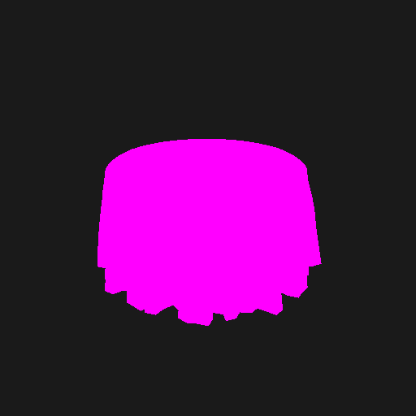
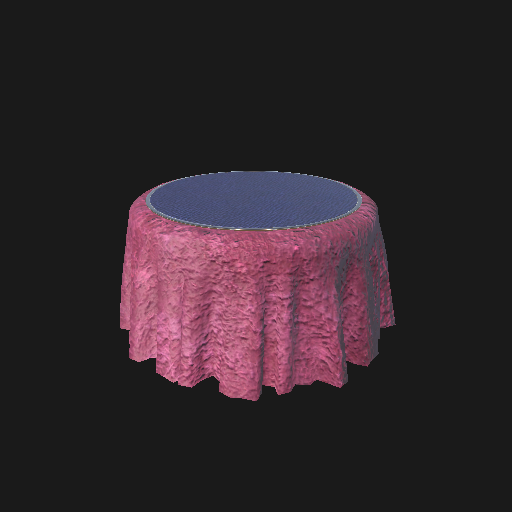
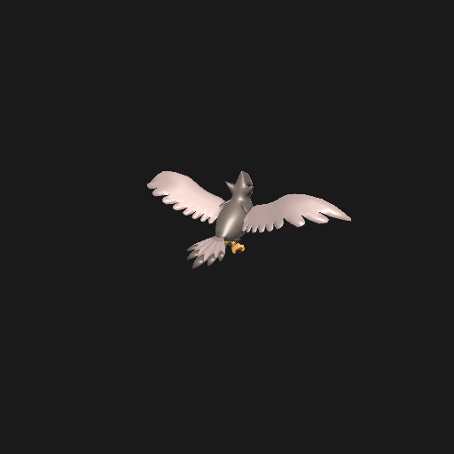

# ADR 0001 — TTS AssetBundles in Unity 6.6 + URP

- **Status:** accepted (2026-10-22)
- **Decides:** render pipeline (URP stays) and how much to invest in the TTS importer.
- **Reproducible evidence:** `tools/tts-analysis/bundle_headers.py`, `tools/unity-probes/ProbeBundles.cs`, `tools/unity-probes/RenderProbe.cs`, images in `docs/adr/assets/`.

## Context

4 of the 6 local mods use `Custom_Assetbundle`, and in 3 of them the bundles are the game's figures (`CLAUDE.md` section 6). AssetBundles depend on the Unity version and pipeline they were built with. We needed to know whether Unity 6.6 + URP loads them and whether materials render correctly or pink before designing the importer.

## What was tested

### 1. Unity version of the bundles (70 files in `Mods/Assetbundles`)

Reading the `UnityFS` header of each file:

| Engine version | Bundles |
|---|---|
| 5.6.2f1 | 51 |
| 5.6.5f1 | 17 |
| 2019.1.0f2 | 1 |
| 5.3.4f1 | 1 |

All are UnityFS format v6 with LZ4HC blocks. Tabletop Simulator itself runs today on **Unity 6000.3.10f1** (`UnityPlayer.dll` of the Steam install), so new mods will bring bundles built with Unity 6.x; the local collection is from the 5.6 era.

### 2. Loading in Unity 6.6.7f1 + URP (Direct3D12), Editor open, via `unity command script eval_file`

Sample of 5 bundles (the 2019.1 one, the 5.3.4 one, the two largest 5.6.x ones and a small 5.6.2 one):

| Bundle | Loads | Content | Material shader |
|---|---|---|---|
| Staraptor (2019.1, Pokémon) | OK | 1 prefab, 9 renderers, 2 Animators, 1 missing script | Standard |
| SteamCube (5.3.4) | OK | 1 prefab, particles | Standard, Legacy/Particles |
| Chimera Table materials (5.6.5) | OK | 4 materials with textures | Standard |
| Love Letter table (5.6.5) | OK | 1 prefab, 3 meshes, 5 297 vertices | Standard |
| Porygon (5.6.2) | OK | 1 prefab, 3 renderers, 2 Animators | Standard |

- **Meshes, textures, hierarchy, Animators and materials deserialize correctly** in all 5 cases, including the 5.3.4 one.
- The console shows `Keyword space mismatch` (the embedded `Standard` shader was compiled with a different keyword space) and the warning **"Serialized files [version 17] before 2019.1 are deprecated. Open and re-save the file"**. Unity is announcing it will stop reading that format in some future version.
- The `missingScripts=1` entries are TTS components (its bundle `MonoBehaviour`) that do not exist here; harmless.

### 3. Pink or correct? Render to texture (512×512) before and after remapping materials

Load-time remap: `Standard` → `Universal Render Pipeline/Lit`, copying `_MainTex→_BaseMap`, `_Color→_BaseColor`, `_BumpMap`, `_MetallicGlossMap`, `_Metallic`, `_Glossiness→_Smoothness`, `_EmissionMap/_EmissionColor`.

| Prefab | Magenta pixels with the original shader | After remapping to URP/Lit |
|---|---|---|
| Staraptor | 9 093 (3 % of drawn pixels) | 0 |
| Love Letter table | 51 989 (20 %) | 0 |
| Porygon | 16 975 (6 %) | 0 |

  

### 4. Steps of the original plan that were not executed

- **Built-in pipeline:** not needed. The URP/Lit remap gives correct materials; switching pipelines does not fix the `Keyword space mismatch` and would cost us URP.
- **Testing with Unity 5.6/2019.1:** unnecessary, the bundles load in 6.6.
- **AssetRipper (GPL, external tool):** deferred to the importer milestone (M7). It only makes sense as an offline conversion path if Unity drops support for the pre-2019.1 format, or for meshes that are not CPU-readable.

## Decision

1. **URP stays.** The pipeline does not change.
2. **TTS AssetBundles are loaded at runtime with `AssetBundle.LoadFromFile` plus a material remapper** (`Standard`/`Legacy` → `URP/Lit` or `URP/Particles`). The remapper is part of the assets milestone (M4) and is reused by the importer (M7).
3. **Every bundle that fails to load, or whose prefab ends up without renderers, is replaced by a placeholder** that keeps id, name, GM notes, container, position and script (`CLAUDE.md` section 6 rule).
4. **We do not depend on the bundle format long term.** Our native asset format is glTF + images. The importer keeps the original bundle in the cache, but the goal is to convert it (see risk below).

## Consequences and risks

- **High risk, uncertain horizon:** Unity marks the pre-2019.1 format as deprecated. 69 of 70 local bundles use it. Mitigation: in M7 evaluate conversion to glTF (AssetRipper offline, or GPU buffer readback for non-readable meshes) and keep a Unity version that still reads it until the conversion exists.
- The Pokémon bundles carry 2 Animators per prefab: decide whether we play their animations (TTS has "AssetBundle effects" with loops and triggers). The minimum is loading them without animating.
- Authors' custom shaders (anything other than `Standard`) will render pink: the remapper needs a fallback table by shader name and must log unknown shaders.
- The Pokémon mods reference 1 026 and 902 unique bundle URLs; only 65 are in the local cache. The importer downloads on demand from the user's own files, cached by hash (`CLAUDE.md` section 6).
- This content (Pokémon, Gloomhaven) is for local testing only; it is never redistributed.

## How to reproduce

```bash
python -I tools/tts-analysis/bundle_headers.py "C:/Users/<user>/Documents/My Games/Tabletop Simulator/Mods/Assetbundles"
# With the Editor open (adjust the paths inside the .cs files):
unity command script eval_file --file tools/unity-probes/ProbeBundles.cs --timeout 120
unity command script eval_file --file tools/unity-probes/RenderProbe.cs --timeout 180
```
