# Developer docs

For Miguel and implementing agents. Start with the system map below, then the flow page for the part you change.
Permanent rules live in [CLAUDE.md](../../CLAUDE.md); context, decisions and risks in [plan.md](../plan.md).

- [System map](#system-map): processes, assemblies, and the boundaries between them.
- Flows (T9.4, one page each):
  - [From a gesture to the table](flows/input-to-command.md): input, `Command`, engines, state events, views.
  - [Multiplayer](flows/multiplayer.md): host authority, prediction, rebuilds, presence, chat, files.
  - Still to write: rules games, MCP and the bridge, asset loading, TTS import, Lua, UI.
- Recipes (T9.5): add an effect, an MCP tool, an object type, a Lua function, a HUD panel, a PlayMode test.

## System map

```mermaid
flowchart LR
    agent["The user's agent<br/>(Claude Code, Codex)"]
    subgraph mcpproc["MCP server process"]
        tools["Game and table tools"]
        bridge_s["Unity bridge (WebSocket server)"]
    end
    subgraph hostexe["Game exe — host"]
        view["Table view, interaction, HUD"]
        session_h["Session host"]
        lua["Lua sandbox (host only)"]
        core_h["core: engine, rules, validator"]
        bridge_c["Bridge client"]
    end
    subgraph clientexe["Game exe — each client"]
        view_c["Table view, interaction, HUD"]
        session_c["Session client: confirmed + predicted"]
        core_c["core: engine"]
    end
    relay(["Unity Relay / LAN (NGO messages)"])
    files[("Game packages, saves,<br/>URL cache, TTS cache")]
    web(["Web: Steam CDN, pastebin"])

    agent -- "stdio (MCP)" --> tools
    tools --> bridge_s
    bridge_s -- "local WebSocket" --> bridge_c
    bridge_c --> core_h
    view -- "Command" --> core_h
    core_h -- "state events" --> view
    lua -- "commands" --> core_h
    core_h --> session_h
    session_h -- "orders, snapshots, assets" --> relay
    relay --> session_c
    session_c -- "intents" --> relay
    relay --> session_h
    session_c --> core_c --> view_c
    view_c -- "Command (predicted)" --> session_c
    view --> files
    view_c --> files
    files -.-> web
```

| Box | Files |
|---|---|
| Game and table tools | [GameTools.cs](../../mcp-server/GameTools.cs), [TableTools.cs](../../mcp-server/TableTools.cs), [GameSession.cs](../../mcp-server/GameSession.cs), [Program.cs](../../mcp-server/Program.cs) |
| Unity bridge (server side) | [UnityBridge.cs](../../mcp-server/UnityBridge.cs) |
| Bridge client | [BridgeClient.cs](../../unity/Assets/_Project/Scripts/View/Bridge/BridgeClient.cs) |
| Table view, interaction, HUD | [TableView.cs](../../unity/Assets/_Project/Scripts/View/TableView.cs), [TableInteraction.cs](../../unity/Assets/_Project/Scripts/View/TableInteraction.cs), [HudController.cs](../../unity/Assets/_Project/Scripts/View/Hud/HudController.cs) |
| core: engine, rules, validator | [TableEngine.cs](../../core/Engine/TableEngine.cs), [GameEngine.cs](../../core/Engine/GameEngine.cs), [TableState.cs](../../core/Rules/TableState.cs), [TableJson.cs](../../core/Rules/TableJson.cs), [TableValidator.cs](../../core/Rules/TableValidator.cs) |
| Lua sandbox | [ScriptHost.cs](../../core/Scripting/ScriptHost.cs), [ScriptApi.cs](../../core/Scripting/ScriptApi.cs), started by [NetworkTableSession.Scripts.cs](../../unity/Assets/_Project/Scripts/View/Net/NetworkTableSession.Scripts.cs) |
| Session host, session client | [TableSync.cs](../../core/Net/TableSync.cs) (`SessionHost`, `SessionClient`), carried by [NetworkTableSession.cs](../../unity/Assets/_Project/Scripts/View/Net/NetworkTableSession.cs) |
| Unity Relay / LAN | [RelayLobby.cs](../../unity/Assets/_Project/Scripts/View/Net/RelayLobby.cs), [ADR 0002](../adr/0002-netcode.md) |
| Assets from files and the web | [AssetLibrary.cs](../../unity/Assets/_Project/Scripts/View/AssetLibrary.cs), [Bundles.cs](../../unity/Assets/_Project/Scripts/View/Bundles.cs), [AssetSync.cs](../../core/Net/AssetSync.cs), [AssetDownloader.cs](../../core/Tts/AssetDownloader.cs) |
| TTS import (writes a game package) | [TtsImporter.cs](../../core/Tts/TtsImporter.cs), [TtsPackage.cs](../../core/Tts/TtsPackage.cs) |

### Assemblies

| Assembly | Built by | Knows | Used by |
|---|---|---|---|
| `Core` (.NET Standard 2.1) | [Core.csproj](../../core/Core.csproj); the build copies `Core.dll` and MoonSharp to `unity/Assets/Plugins/Core/` | Nothing of Unity | The game, the MCP server, `core.tests` |
| `TableWorld.Runtime` | Unity ([asmdef](../../unity/Assets/_Project/Scripts/TableWorld.Runtime.asmdef)) | Core, Unity, NGO, UI Toolkit | The game |
| `TableWorld.Editor` | Unity ([asmdef](../../unity/Assets/_Project/Editor/TableWorld.Editor.asmdef)) | Runtime, Unity Editor | Scene and asset builders, menu commands |
| `McpServer` (net9) | [McpServer.csproj](../../mcp-server/McpServer.csproj) | Core, ModelContextProtocol | The user's agent, over stdio |

### Boundaries and the principle each one keeps

| Boundary | Carries | Principle ([CLAUDE.md §3](../../CLAUDE.md)) |
|---|---|---|
| `Core.dll` ↔ Unity | Commands in, state events out; Unity reads state, never writes it | 1: core does not know Unity; 3: every interaction becomes a `Command` |
| Agent ↔ MCP server (stdio) | Board-game tools (`create_deck`, `define_zone`, `perform_action`) | 2: the MCP server speaks board games, not Unity |
| MCP server ↔ game (local WebSocket, `bridge.json` with port and token) | Load a table, perform a command, read the state | 2 |
| Host ↔ clients (NGO named messages over Relay or LAN) | Intents up; ordered commands, snapshots, presence, chat and asset chunks down | 3: authoritative host; clients predict and rebuild |
| Lua sandbox ↔ engine | Commands through the host's executor; no file, OS or loading access; step budget | 4: no user C#; only validated JSON and sandboxed Lua |
| TTS save ↔ table model | One-to-one primitives, placeholders that keep ids, names and scripts | 5: TTS-compatible in the data model |
