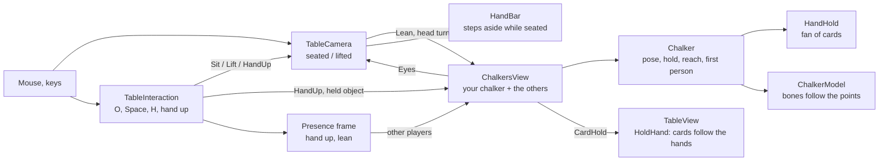

# The camera: seated in first person, or lifted

For whoever changes the camera, the player's own chalker or how hands of cards are shown. The player's camera has two
heights. **Seated** (the default) it looks out of the player's own chalker's eyes in their chair. **Lifted** it is
the TTS-style orbit camera over the table. Neither is a separate camera: lifting and sitting blend one camera between
the two over 0.4 s, so the view rises out of your head instead of cutting.

| Box | Files |
|---|---|
| TableCamera | [TableCamera.cs](../../unity/Assets/_Project/Scripts/View/TableCamera.cs): `Sit`, `Lift`, `ToggleSeated`, `SetSeat`, `FirstPerson`, `Lean`, the seated controls (`Seated`) |
| TableInteraction | [TableInteraction.cs](../../unity/Assets/_Project/Scripts/View/TableInteraction.cs): `ToggleSeatView` (O), `HandUp`, `ToggleHandUp` (H), `UpdateHand` |
| ChalkersView | [ChalkersView.cs](../../unity/Assets/_Project/Scripts/View/Chalkers/ChalkersView.cs): `Yours`, `Yourself`, `Covers`, `Prepare`, `HoldCards` |
| Chalker | [Chalker.cs](../../unity/Assets/_Project/Scripts/View/Chalkers/Chalker.cs): `HoldingCards`, `RaiseHand`, `CardHold`, `ReachFor`, `LeanIn`, `SteadyEyes`, `HideHead`, `Ghost`; [ChalkerGhost.cs](../../unity/Assets/_Project/Scripts/View/Chalkers/ChalkerGhost.cs), [Ghost.shader](../../unity/Assets/_Project/Shaders/Ghost.shader) |
| ChalkerModel | [ChalkerModel.cs](../../unity/Assets/_Project/Scripts/View/Chalkers/ChalkerModel.cs): `HideBody`, holding hands, `FaceDepth` |
| HandHold | [HandHold.cs](../../unity/Assets/_Project/Scripts/View/Chalkers/HandHold.cs), [TwoBoneIk.cs](../../unity/Assets/_Project/Scripts/View/Chalkers/TwoBoneIk.cs) |
| TableView | [TableView.cs](../../unity/Assets/_Project/Scripts/View/TableView.cs): `HoldHand`, `HeldByChalker`, `HandCardCount` |
| HandBar | [HandBar.cs](../../unity/Assets/_Project/Scripts/View/Hud/HandBar.cs) |
| Presence frame | [Presence.cs](../../core/Net/Presence.cs) (`HandUp`, `Lean`), [NetworkTableSession.Presence.cs](../../unity/Assets/_Project/Scripts/View/Net/NetworkTableSession.Presence.cs) |
| Tests | [FirstPersonTests.cs](../../unity/Assets/_Project/Tests/PlayMode/FirstPersonTests.cs), [SeatingTests.cs](../../unity/Assets/_Project/Tests/PlayMode/SeatingTests.cs), [PresenceTests.cs](../../core.tests/Net/PresenceTests.cs) |

## Seated and lifted

| | Seated | Lifted |
|---|---|---|
| Right drag | turns the head (110° each way, 35° up, 80° down) | orbits |
| Wheel | leans in over the table (four steps); sitting back, three steps out in a row lift you (each gives a little; a pause settles back) | zooms |
| WASD, middle drag, Shift + right drag | lifts you, then pans | pans |
| Q / E (nothing hovered) | turns the head | turns the camera |
| Space | stays seated, head straight | sits you (stays lifted with the free camera setting) |
| O | lifts you | sits you |
| P, Z | top-down, quick zoom; again goes back to the seat | as before |

The game starts seated. The setting **Camera: Free camera only** (`GameSettings.FreeCamera`) keeps the orbit camera for
Space and the start of a game, for motion sickness or taste; O still sits you. Your hand then stands at your edge of
the table as in TTS instead of in your chalker's hands. A spectator has no seat and stays lifted.

The camera does not own the seat. Every frame `ChalkersView` poses your own chalker (leaning with `TableCamera.Lean`,
the head turned where you look) and hands its eyes back with `SetSeat`. The eye point is the shapes' eyes with the head
held straight (`Chalker.SteadyEyes`), whatever model is worn, so every model holds the cards in the same place in your
view. Only leaning in carries it (gliding, `Chalker.LeanRate`): turning the head turns the view in place instead of
swinging it round the neck, and emotes, sway and breathing leave it still.

## Your own chalker

Every seat has a chair, yours too, and your chalker sits in it. Lifted, you see it from outside: that one is you.
Seated, the camera is inside its head:

- Nothing of your chalker is drawn but its shadow (`Chalker.HideHead`, `ChalkerModel.HideBody`): no head, body or
  arms between your eyes and the table. Your shadow on the table is still the whole model.
- Your cards stay in the hand bar and at your edge of the table, as in TTS (hover a card to raise it into full view):
  your own chalker never holds them on your screen. The other players' machines pose it holding them (Miguel,
  2026-10-28: reading a held fan in first person was a nightmare; function first).

Your mouth moves with your microphone, your emotes play on it, and while you carry something its right arm reaches for
it (`Chalker.ReachFor`, within 1.1 m). Other players' chalkers reach for what they carry the same way.

## Holding cards

Another player's chalker holds that seat's cards in a fan (`HandHold`) in its left hand, the right one free (it rests,
reaches, raises a thumb), instead of standing them at its hand zone. The arm is posed first, wrist raised at chest height
out on the hand's own side, the elbow pointed out and down so the forearm rises and the hand, left as the model was made, points its fingers up; then the
cards are put in those fingers, on the side facing the eyes (`ChalkerModel.CardsInHand`). Moving the hand to the cards
left it hanging under them or twisted it.
The cards stay in the hand zone as far as the rules are concerned: this is view only, like the TTS stand it replaces.
`TableView.HoldHand` places each card every frame, at the render rate, so cards move with the hands. A seat nobody sits
in keeps its cards standing at the zone, and so does yours, always: read from above, TTS style, with the hand bar. The
holder's palms lie on the cards' backs, fingers up them, so from across the table you see the backs of its fingers.

- **Lowered**: the grip over the table's edge at chest height, the cards leaning back 40°. Seated, they peek in at the
  bottom of the view.
- **Raised**: under the chin, the cards nearly upright, facing the eyes. A face further forward (a snout) pushes the fan
  out to stay 0.12 m in front of it (`HandHold.FaceClearance`, `ChalkerModel.FaceDepth`).

The fan opens up to 64°, 9° between cards. A worn model's wrists sit well below the fan's foot and a little behind it,
its fingers lying up the cards' backs, so the faces stay readable.

**Resting hands.** A seated worn model whose hand rests on the table (lower than `ChalkerModel.RestHeight` over the
table top, holding nothing) lays it flat: palm down, fingers forward and a little out, lifted by the hand's own
thickness, so a cartoon hand does not sink into the table's rim. The back of the hand is measured in the bind pose.

**Raising the hand.** The cards come up when the pointer goes onto one of them. They stay up while the pointer is over
them, or across their width and no higher than their top. They drop 0.35 s after it leaves. H
(`GameAction.HandUp`) keeps them up until pressed again. Other players see your hand go up and you lean in (presence
`hand`, `lean`).

**The hand bar** (the TTS hand at the bottom of the screen) always shows your own cards; it steps aside only on a
machine whose own chalker holds them, which today none does.

## Checking it

`FirstPersonTests` covers the following, with `SeatingTests` for the seat view:

- the cards held in the fan;
- the hand bar stepping aside;
- raising (the cards in front of the eyes, facing them, the hand on the fan);
- lifting out;
- turning the head without moving the eyes;
- fading where it covers the table, solid again from across it;
- the free camera setting.

To look at it, load a table with a hand of cards in Play mode and render `Camera.main` into a texture: `capture
game_view` can return a stale frame while the Editor is in the background.
