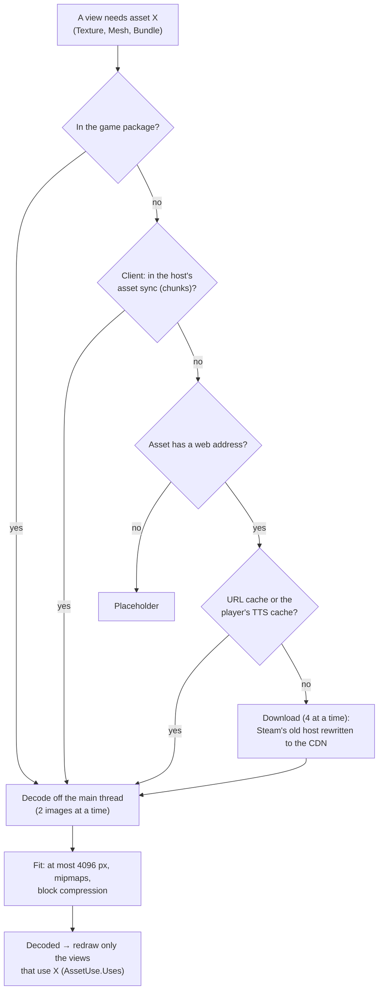

# Flow: loading assets

Images, OBJ models and Unity asset bundles named by a table. Every machine loads them on its own; nothing waits for
them (pieces show plain colours until their image lands) and nothing loads twice.

| Box | Files |
|---|---|
| Asset library: package files, URL cache, TTS cache, web, decode, fit | [AssetLibrary.cs](../../../unity/Assets/_Project/Scripts/View/AssetLibrary.cs) (`Texture`, `Mesh`, `Bundle`, `PackageFile`, `LocalCopy`, `FetchFromWeb`, `Decode`, `Fit`, `Translucent`) |
| Where to fetch an address from today | [TableState.cs](../../../core/Rules/TableState.cs) (`Asset.FetchAddress`) |
| Which views an asset concerns | [AssetUse.cs](../../../core/Rules/AssetUse.cs), used by `TableView.ShowDecoded` |
| Files for clients (manifest, chunks, cache) | [AssetSync.cs](../../../core/Net/AssetSync.cs) |
| Asset bundles and the URP remap | [Bundles.cs](../../../unity/Assets/_Project/Scripts/View/Bundles.cs) (`Prefab`, `Attach`, `Remap`), [ADR 0001](../../adr/0001-assetbundles.md) |
| OBJ models | [ObjMesh.cs](../../../core/Models/ObjMesh.cs) |
| Download in bulk after an import | [AssetDownloader.cs](../../../core/Tts/AssetDownloader.cs) |

## Rules worth knowing

- **The address is the name.** An asset with a `url` keeps that address as its identity (the URL cache and the TTS
  cache are keyed by it, `TtsImporter.CacheKey`); only the download goes to Steam's current host
  (`cloud-3.steamusercontent.com` answers 403).
- **Two decodes at a time.** Each decode holds the full-size pixels until it is fitted (a 7 151 × 3 253 TTS panel is
  93 MB); decoding a heavy table's images together ran the Editor out of memory.
- **A decoded image redraws only the views that use it.** Redrawing every view for each of hundreds of images stalled
  loading.
- **Bundles built for Unity 5.6–2019 load in 6.6**; their materials are remapped to URP Lit at load time.

## Where to put a breakpoint

| Question | Breakpoint |
|---|---|
| Where did this image come from? | `AssetLibrary.Texture` |
| Why is it still grey? | `AssetLibrary.FetchFromWeb` (the warning names the failure) |
| Why is a bundle pink? | `Bundles.Remap` |
