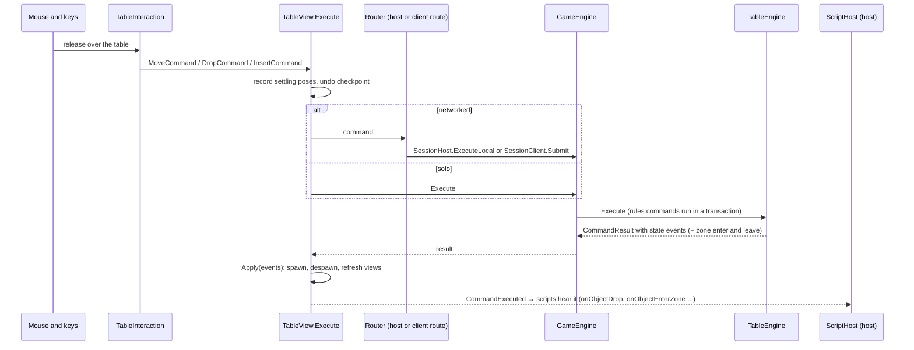

# Flow: from a gesture to the table

How a player's gesture (drop a card, flip, take from a deck) becomes a `Command`, changes the table, and shows on
screen. Solo and on the host the command runs here; on a client it is predicted here and confirmed by the host (see
[multiplayer](multiplayer.md)).

| Step | Files |
|---|---|
| Gestures → commands | [TableInteraction.cs](../../../unity/Assets/_Project/Scripts/View/TableInteraction.cs) (`Grab`, `DragTo`, `Release`, `ReleaseOne`, `Flip`, `DrawOrSwitch`) |
| Entry point for every command | [TableView.cs](../../../unity/Assets/_Project/Scripts/View/TableView.cs) (`Execute`, `Apply`, `ApplyRemote`, `Router`) |
| Routes when networked | [NetworkTableSession.cs](../../../unity/Assets/_Project/Scripts/View/Net/NetworkTableSession.cs) (`HostRoute`, `ClientRoute`) |
| Rules games (phases, actions, wins) | [GameEngine.cs](../../../core/Engine/GameEngine.cs) (`Execute`, `Transaction`) |
| Table commands | [TableEngine.cs](../../../core/Engine/TableEngine.cs) (`Execute`, `Dispatch`, `WithZoneEvents`), commands in [Commands.cs](../../../core/Engine/Commands.cs) and [EditCommands.cs](../../../core/Engine/EditCommands.cs) |
| State events | [StateEvents.cs](../../../core/Engine/StateEvents.cs) |
| Scripts hearing commands (host) | [NetworkTableSession.Scripts.cs](../../../unity/Assets/_Project/Scripts/View/Net/NetworkTableSession.Scripts.cs) (`ScriptsHear`), [ScriptHost.cs](../../../core/Scripting/ScriptHost.cs) (`OnCommand`) |

## Rules worth knowing

- **The view never changes state itself.** Physics moves views; when a body comes to rest, `TableView.LateUpdate`
  records its pose with a `MoveCommand` (`ReportPose`). Everything else is a command.
- **A refused command is normal play**: the result carries a `ValidationError` (code, message, suggestion) and the HUD
  shows it; nothing is logged as a warning.
- **Zone events are derived** by the engine after every command (`WithZoneEvents`): the commands themselves never raise
  them.
- **Undo** takes a checkpoint before each player command (`Checkpoint`), not before pose reports or script commands.

## Where to put a breakpoint

| Question | Breakpoint |
|---|---|
| Which command did this gesture send? | `TableView.Execute`, first line |
| Why was it refused? | `TableEngine.Dispatch`, then the command's method (`Move`, `Insert` ...) |
| Why did a view not update? | `TableView.Apply`, the event's case |
| Why did a script not react? | `ScriptHost.OnCommand` |
