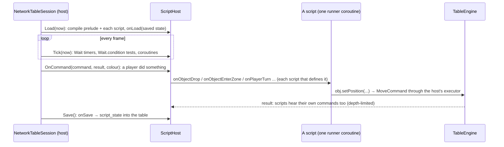

# Flow: Lua scripts

Table scripts (the global one and each object's) run on the host only, in MoonSharp's soft sandbox, and change the
table only through commands ([ADR 0003](../../adr/0003-lua-scripting.md)). The API follows Tabletop Simulator's names so
imported games run as written; its full list is generated in [reference/lua-api.md](../../reference/lua-api.md).

| Box | Files |
|---|---|
| The host: loading, events, timers, budget, runners | [ScriptHost.cs](../../../core/Scripting/ScriptHost.cs) (`Load`, `Tick`, `OnCommand`, `ForObject`, `Everywhere`, `Save`, `RunFor`, `RunOnRunner`) |
| The API: globals, object proxies and their members | [ScriptApi.cs](../../../core/Scripting/ScriptApi.cs) (`InstallApi`, `Proxy`, `ObjectMethod`, `LiveProperty`, `SpawnObject`, `MusicApi`, `GridApi`, `TurnsApi`) |
| `UI.*`: script UI as a tree in the table | [ScriptUiApi.cs](../../../core/Scripting/ScriptUiApi.cs), [ADR 0004](../../adr/0004-script-ui.md) |
| `Physics.*` casts (answered by the view) | [ScriptPhysicsApi.cs](../../../core/Scripting/ScriptPhysicsApi.cs) |
| Vector, Color and helpers in Lua | [LuaPrelude.cs](../../../core/Scripting/LuaPrelude.cs) |
| Wiring in the game | [NetworkTableSession.Scripts.cs](../../../unity/Assets/_Project/Scripts/View/Net/NetworkTableSession.Scripts.cs) (`LoadScripts`, `TickScripts`, `ScriptsHear`, `SaveScripts`) |
| Tests | [ScriptHostTests.cs](../../../core.tests/Scripting/ScriptHostTests.cs) (hostile scripts), [ScriptCompatTests.cs](../../../core.tests/Scripting/ScriptCompatTests.cs) (TTS calls), [LocalModInteractionsTests.cs](../../../core.tests/Scripting/LocalModInteractionsTests.cs) (real mods) |

## Rules worth knowing

- **The sandbox**: no `io`, `os.execute`, `load`, `dofile` or `require`; `string.rep` is capped; every call runs with
  a step budget (10 000 per slice, 2 000 000 per call) and an endless loop is stopped, not the host.
- **One runner coroutine per script.** Making a MoonSharp coroutine costs about 0.25 ms; each script keeps one that
  calls every function under `pcall` and still yields every slice. A call made while it runs (a handler whose command
  wakes another handler of the same script) gets a coroutine of its own.
- **Object proxies build their methods on first use** (Gloomhaven's scripts touch over 100 000 proxies); TTS member
  variables such as `resting` or `is_face_down` are read live each time, never cached.
- **Clients never run scripts**; they receive what scripts did as ordinary ordered commands.

## Where to put a breakpoint

| Question | Breakpoint |
|---|---|
| Why did a handler not run? | `ScriptHost.ForObject` |
| What did this API call do? | the member's `case` in `ScriptApi.ObjectMethod` |
| Why was a script stopped? | `ScriptHost.RunOnRunner` (budget) |
