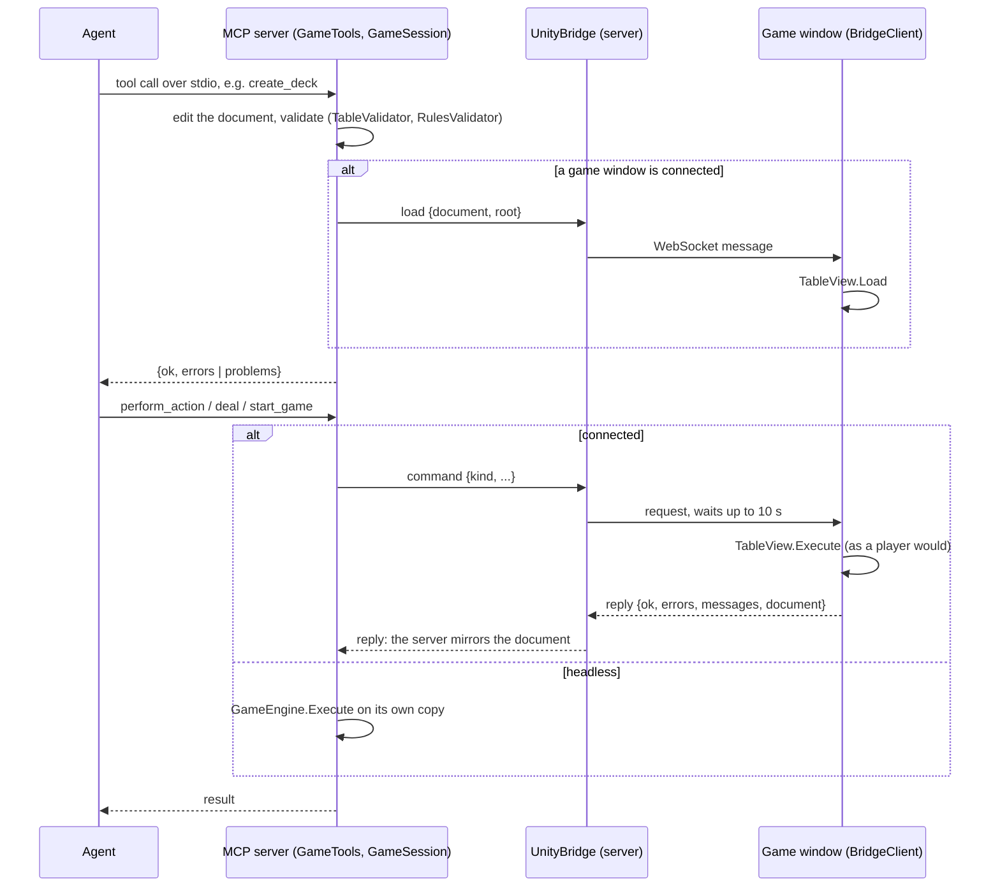

# Flow: the MCP server and the game window

The user's own agent (Claude Code, Codex) builds and plays games through the MCP server, which speaks board games, not
Unity (CLAUDE.md principle 2). The server keeps the game document; when a game window is open it mirrors the document
there over a local WebSocket, so the person sees the table being built and can play in it.

| Box | Files |
|---|---|
| Tools (authoring, play, table actions) | [GameTools.cs](../../../mcp-server/GameTools.cs), [TableTools.cs](../../../mcp-server/TableTools.cs); the list with parameters is generated in [reference/mcp-tools.md](../../reference/mcp-tools.md) |
| The game document, headless play, push and mirror | [GameSession.cs](../../../mcp-server/GameSession.cs) (`Edit`, `Validate`, `PushToGame`, `Mirror`, `RemoteCommand`, `Start`, `Execute`) |
| Server side of the bridge | [UnityBridge.cs](../../../mcp-server/UnityBridge.cs) (`DiscoveryPath`, `Request`, `Send`) |
| Game side of the bridge | [BridgeClient.cs](../../../unity/Assets/_Project/Scripts/View/Bridge/BridgeClient.cs) (`Handle`, `Execute`) |
| Startup, stdio | [Program.cs](../../../mcp-server/Program.cs) |
| Contract and end-to-end tests | [McpContractTests.cs](../../../mcp-server.tests/McpContractTests.cs), [BridgeEndToEndTests.cs](../../../mcp-server.tests/BridgeEndToEndTests.cs) |

## Rules worth knowing

- **Discovery.** The server listens on 127.0.0.1 at a random port and writes `{port, token, pid}` to
  `%LOCALAPPDATA%/TableWorld/bridge.json`; the game reads it and connects with the token. No port is fixed, nothing
  listens beyond this machine.
- **The server never runs on `dotnet run`**: build output on stdout would break the MCP stream. Build, then run the
  DLL (CLAUDE.md §9).
- **The window wins.** When a person plays in the game window, the game reports the new state and the server mirrors
  it, so the agent's next `get_table_state` sees what the person did.
- **Commands from the agent are performed as a player would** (`TableView.Execute`), so the same validation, undo
  and multiplayer routing apply.
- **Questions to the person** go through `ask_host`, which the agent uses when the rulebook is ambiguous.

## Where to put a breakpoint

| Question | Breakpoint |
|---|---|
| What did the agent ask for? | the tool method in `GameTools` or `TableTools` |
| Did the game get the command? | `BridgeClient.Handle` |
| Why did the agent see a timeout? | `UnityBridge.Request` (10 s) |
