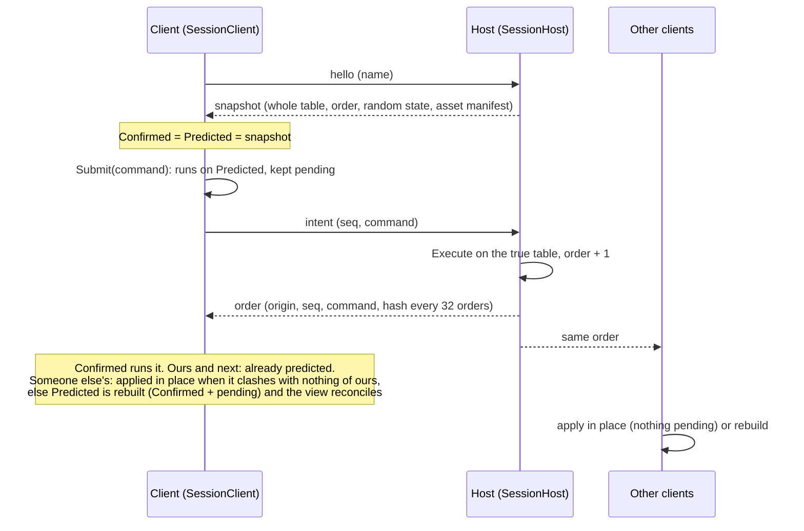

# Flow: multiplayer

The host is authoritative (CLAUDE.md principle 3, [ADR 0002](../../adr/0002-netcode.md)). It owns the one true order of
commands; clients predict their own commands so gestures feel immediate, and fix the prediction when the host orders
things differently. Netcode for GameObjects is only a message pipe: every message is JSON from `core/Net`.

| Part | Files |
|---|---|
| Host and client protocol | [TableSync.cs](../../../core/Net/TableSync.cs): `SessionHost` (`Snapshot`, `Receive`, `ExecuteLocal`, `HashEvery`), `SessionClient` (`Submit`, `Receive`, `ApplyOrder`, `Commutes`, `Rebuild`), `CommandCodec` |
| Carrying messages over NGO, seats, routing | [NetworkTableSession.cs](../../../unity/Assets/_Project/Scripts/View/Net/NetworkTableSession.cs) (`HostRoute`, `ClientRoute`, `OnClientMessage`, `NewHost`) |
| Join codes (Unity Relay) | [RelayLobby.cs](../../../unity/Assets/_Project/Scripts/View/Net/RelayLobby.cs) |
| A rebuilt prediction on screen | [TableView.cs](../../../unity/Assets/_Project/Scripts/View/TableView.cs) (`Reconcile` for a rebuild, `Adopt` for a snapshot) |
| Presence (pointers, held objects) | [Presence.cs](../../../core/Net/Presence.cs), [NetworkTableSession.Presence.cs](../../../unity/Assets/_Project/Scripts/View/Net/NetworkTableSession.Presence.cs), [PresenceView.cs](../../../unity/Assets/_Project/Scripts/View/Net/PresenceView.cs) |
| Voice and chalkers (T7.3) | [Voice.cs](../../../core/Net/Voice.cs) (binary packet codec, Opus encoder, `VoiceStream` jitter buffer, `VoiceGate`, `MouthFollower`), [NetworkTableSession.Voice.cs](../../../unity/Assets/_Project/Scripts/View/Net/NetworkTableSession.Voice.cs), [VoiceChat.cs](../../../unity/Assets/_Project/Scripts/View/Voice/VoiceChat.cs), [VoiceSpeaker.cs](../../../unity/Assets/_Project/Scripts/View/Voice/VoiceSpeaker.cs), [ChalkersView.cs](../../../unity/Assets/_Project/Scripts/View/Chalkers/ChalkersView.cs) (each seat's place at the table and its chair, T11.10), [ChalkerChair.cs](../../../unity/Assets/_Project/Scripts/View/Chalkers/ChalkerChair.cs) |
| Chat and the game log | [Chat.cs](../../../core/Net/Chat.cs), [NetworkTableSession.Chat.cs](../../../unity/Assets/_Project/Scripts/View/Net/NetworkTableSession.Chat.cs) |
| Players, seats, roles | [Players.cs](../../../core/Net/Players.cs), [Seating.cs](../../../core/Net/Seating.cs), [NetworkTableSession.Players.cs](../../../unity/Assets/_Project/Scripts/View/Net/NetworkTableSession.Players.cs) |
| Files for clients | [AssetSync.cs](../../../core/Net/AssetSync.cs) (manifest with hashes, chunks, client cache); web addresses each machine fetches itself ([AssetLibrary.cs](../../../unity/Assets/_Project/Scripts/View/AssetLibrary.cs)) |
| Simulations | [TableSyncTests.cs](../../../core.tests/Net/TableSyncTests.cs) (random interleavings), [LatencySimulationTests.cs](../../../core.tests/Net/LatencySimulationTests.cs) (200 ms, 2 % loss) |

## Rules worth knowing

- **Determinism carries the protocol.** The engine draws random numbers from one seeded generator whose state travels
  in the snapshot, so a command gives the same result everywhere in the same order. That is why ours, ordered next,
  needs no check, and why a hash every 32 orders is enough to catch a bug.
- **Prediction rebuilds are the expensive path**: copying a 2 800-object table costs about 320 ms. A command from
  someone else is applied in place when it is a plain gesture (move, flip, lock, pick up, drop, properties, scale,
  insert) that draws no random number, creates nothing and touches nothing our pending commands touched. Shuffles,
  rolls, deals and takes still rebuild.
- **The view follows a rebuild** with `Reconcile`: every view points at the new engine's object, only the objects the
  rebuild names redraw. `Adopt` (respawn everything) is for snapshots and resyncs.
- **Scripts run only on the host.** Clients receive what scripts did as ordinary ordered commands.
- **Voice is the one binary message.** 20 ms Opus frames (about 60 bytes) go unreliable to the host, which stamps
  the sender's seat and relays them. Each listener keeps a `VoiceStream` per speaker: 60 ms of jitter room, Opus
  concealment for a lost frame, and a cut back to 60 ms when more than 200 ms piles up. Playback pulls the stream in
  `OnAudioFilterRead` (a streamed `AudioClip` reads about a second ahead, too late for talking). The microphone runs
  only online or with Settings → Voice → Hear myself, which loops your voice through the same path to a mirror chalker.
  Every seat but your own has a chair at the table's edge, played or not (M10 T11.10): level with the seat's hand zone
  on the nearest edge, or, for seats without one, spread evenly round the table in seat order. A player's chalker sits
  on its seat's chair, hands on the table.
- **Host-only commands** (`IHostCommand`: physics mode, grid, music, script UI ...) are refused from clients unless the
  host promoted them.

## Where to put a breakpoint

| Question | Breakpoint |
|---|---|
| Did the host get my command? | `SessionHost.Receive` |
| Why did my client rebuild? | `SessionClient.ApplyOrder`, the line before `Rebuild` |
| Why did a client resync? | `SessionClient.Resync` (a hash mismatch or a gap in the order) |
| What does the client send? | `NetworkTableSession.ClientRoute` |
