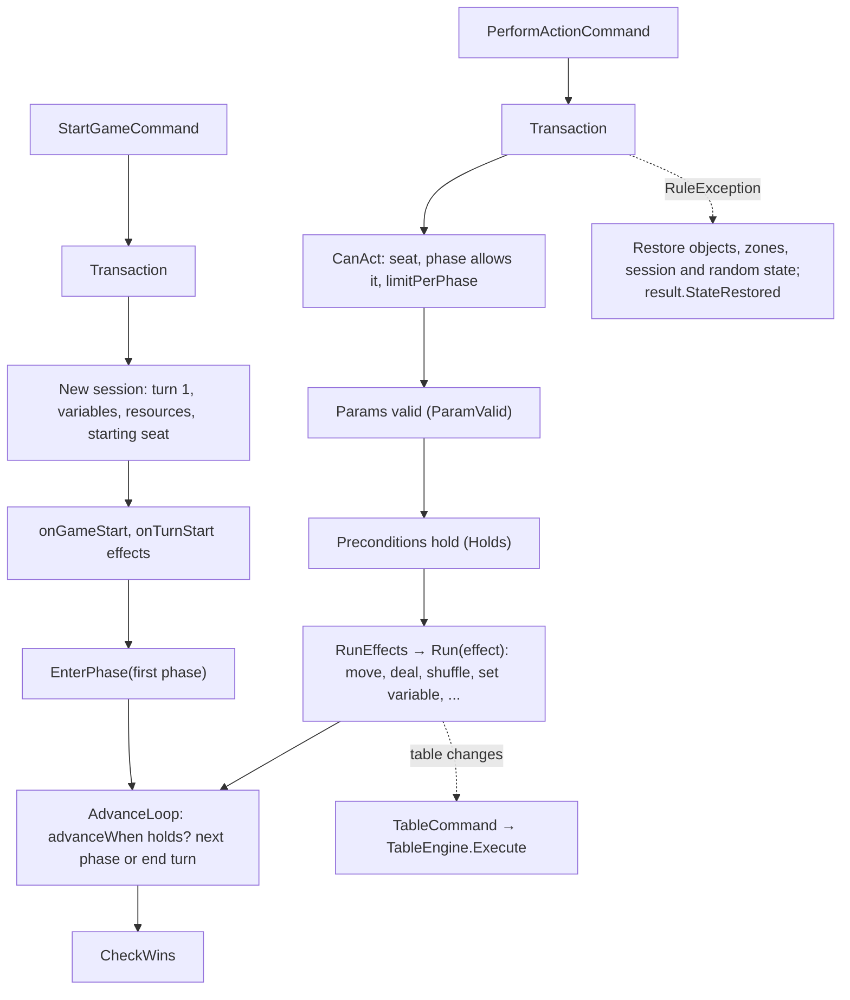

# Flow: a rules game

A table can carry rules (turn, phases, actions, events, win conditions; [rules-schema.md](../../rules-schema.md)).
`GameEngine` wraps `TableEngine`: free-play commands keep working during a game, and rules commands run as
transactions that either apply completely or leave the table as it was.

| Box | Files |
|---|---|
| Transactions, start, actions, phases, turns, wins | [GameEngine.cs](../../../core/Engine/GameEngine.cs) (`Transaction`, `StartGame`, `Perform`, `CanAct`, `EnterPhase`, `AdvanceLoop`, `EndTurn`, `CheckWins`, `LegalActions`) |
| Effects and conditions (data) | [Effects.cs](../../../core/Rules/Effects.cs), [GameRules.cs](../../../core/Rules/GameRules.cs) |
| Effects and conditions (meaning) | [GameEngine.cs](../../../core/Engine/GameEngine.cs) (`Run`, `Move`, `Deal`, `Deliver`, `Holds`, `Contains`) |
| References such as `$actor.deck` | [References.cs](../../../core/Rules/References.cs) |
| Rules commands | [GameCommands.cs](../../../core/Engine/GameCommands.cs) |
| Validation of rules documents | [RulesValidator.cs](../../../core/Rules/RulesValidator.cs) |
| Game UI declared in the rules | [GameUi.cs](../../../core/Rules/GameUi.cs), rendered by [GameUiRenderer.cs](../../../unity/Assets/_Project/Scripts/View/Hud/GameUiRenderer.cs) |
| Simulations | [GamePlayTests.cs](../../../core.tests/Engine/GamePlayTests.cs) (`TW_GAMES=1000` plays random games of War and UNO-lite) |

## Rules worth knowing

- **All or nothing.** A rules command that fails midway throws a `RuleException`; the transaction restores objects,
  zones, session and random state, and the view rebuilds every object (`StateRestored`).
- **The session is the game's progress** (turn, current seat, phase, variables, resources, who acted). It is part of
  the table, so a save is a resumable game.
- **Wins are checked after every command** or at turn end, as each condition's `checkAfter` says; `when` is the condition, evaluated once per seat.
- **Legal actions** for a seat come from `LegalActions`; the HUD and the MCP server's `get_table_state` both use them.

## Where to put a breakpoint

| Question | Breakpoint |
|---|---|
| Why can this seat not act? | `GameEngine.CanAct` |
| Why did the phase not advance? | `GameEngine.AdvanceLoop` |
| Why was the table rolled back? | the `catch (RuleException)` in `GameEngine.Transaction` |
| What did an effect do? | `GameEngine.Run` |
