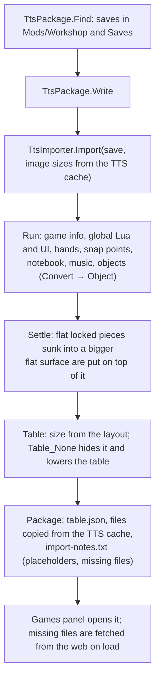

# Flow: importing a Tabletop Simulator game

A save from the player's own TTS folder becomes one of our game packages: `table.json` plus the files the table
needs, copied from the player's TTS cache. Nothing is downloaded from the Workshop or shared (CLAUDE.md §6).

| Box | Files |
|---|---|
| Finding saves, writing the package | [TtsPackage.cs](../../../core/Tts/TtsPackage.cs) (`Find`, `Write`, `CachedFile`, `FolderName`) |
| Save → table | [TtsImporter.cs](../../../core/Tts/TtsImporter.cs) (`Import`, `Run`, `Convert`, `Object`, `Card`, `Deck`, `Model`, `Zone`, `Snap`, `Hands`, `Music`, `Settle`, `Table`, `Lower`) |
| Units and sizes | [TtsUnits.cs](../../../core/Tts/TtsUnits.cs) (`TtsUnitsToMeters`, `TableSurfaceY`, `CardSize`) |
| Image sizes from file headers | [ImageSize.cs](../../../core/Tts/ImageSize.cs) |
| Every mapping, with the evidence for it | [tts-mapping.md](../../tts-mapping.md), [ADR 0005](../../adr/0005-image-facing.md) (which way images face) |
| Checking a real mod | [LocalModInteractionsTests.cs](../../../core.tests/Scripting/LocalModInteractionsTests.cs) (`TW_TTS_DIR`, `TW_MOD`: presses every button and UI element, reports errors and slow clicks) |

## Rules worth knowing

- **Ids are TTS GUIDs**, so scripts' `getObjectFromGUID` finds what they expect.
- **Nothing is dropped.** A TTS object without a counterpart becomes a placeholder model that keeps its id, name,
  description, GM notes, container, position and script; `import-notes.txt` lists it.
- **TTS conventions are kept in the data and honoured by the renderer**: a flat image reads upright from +Z at yaw 0,
  buttons too, object XmlUI the other way round (ADR 0005); tiles keep their depth and take their image's proportions
  in width; a tint's alpha hides or fades the shape.
- **Every rule is backed by local evidence** (the six local mods), recorded in `tts-mapping.md`. A fix tuned to one
  save that breaks another is not a fix.

## Where to put a breakpoint

| Question | Breakpoint |
|---|---|
| What did this TTS object become? | `TtsImporter.Object`, its `case` |
| Why did a piece move on import? | `TtsImporter.Settle` or `Lower` |
| Which files are missing? | `TtsPackage.Write` (`Missing`) |
