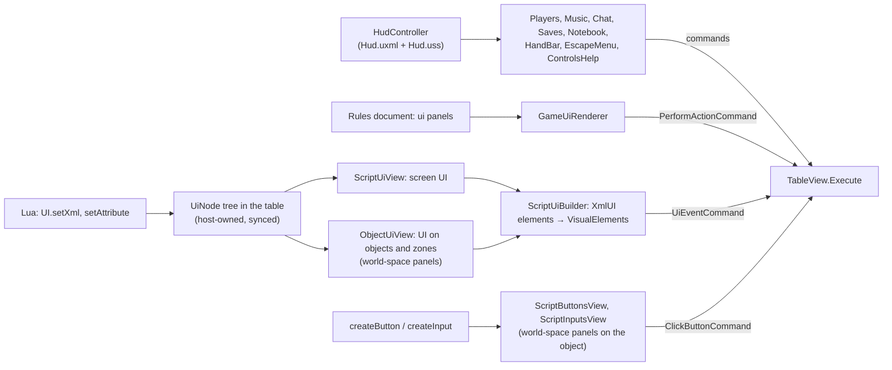

# Flow: user interface

Three kinds of UI, all UI Toolkit, all styled in USS (never inline styles), one `PanelSettings` asset:

- **The HUD**: the game's own panels (players, chat, saves, notebook, hand drawer, controls help, settings).
- **Declarative game UI**: panels a rules document declares (labels, counters, buttons that perform rules actions).
- **Script UI**: what Lua scripts build with `UI.setXml`/`self.UI` (Tabletop Simulator's XmlUI vocabulary), on screen or
  on objects and zones, plus script buttons and inputs on objects.

| Box | Files |
|---|---|
| HUD | [HudController.cs](../../../unity/Assets/_Project/Scripts/View/Hud/HudController.cs), [Hud.uxml](../../../unity/Assets/_Project/UI/Hud/Hud.uxml), [Hud.uss](../../../unity/Assets/_Project/UI/Hud/Hud.uss), panels in [Hud/](../../../unity/Assets/_Project/Scripts/View/Hud/) |
| Hand drawer | [HandBar.cs](../../../unity/Assets/_Project/Scripts/View/Hud/HandBar.cs) |
| Declarative game UI | [GameUi.cs](../../../core/Rules/GameUi.cs), [GameUiRenderer.cs](../../../unity/Assets/_Project/Scripts/View/Hud/GameUiRenderer.cs) |
| Script UI model and API | [ScriptUi.cs](../../../core/Rules/ScriptUi.cs), [ScriptUiApi.cs](../../../core/Scripting/ScriptUiApi.cs), [ADR 0004](../../adr/0004-script-ui.md) |
| Script UI on screen, on objects, element builder | [ScriptUiView.cs](../../../unity/Assets/_Project/Scripts/View/ScriptUi/ScriptUiView.cs), [ObjectUiView.cs](../../../unity/Assets/_Project/Scripts/View/ScriptUi/ObjectUiView.cs), [ScriptUiBuilder.cs](../../../unity/Assets/_Project/Scripts/View/ScriptUi/ScriptUiBuilder.cs) |
| Script buttons and inputs | [ScriptButtonsView.cs](../../../unity/Assets/_Project/Scripts/View/ScriptButtonsView.cs), [ScriptInputsView.cs](../../../unity/Assets/_Project/Scripts/View/ScriptInputsView.cs) |

## Rules worth knowing

- **Load the `unity:ui-uitk` skill** before writing UXML, USS or UI Toolkit C# (CLAUDE.md §4). Styling lives in USS;
  code sets only positions, sizes and runtime images.
- **Themes** (M12): a table's `environment.theme` puts a class on the HUD root (`theme-parchment`); every rule of a
  theme lives under that class at the end of Hud.uss. Engine lines are coloured as they are shown
  ([Highlights.cs](../../../core/Text/Highlights.cs), `HudController.Rich`): seats, teams, roles and vote options in
  their colours, readable on the theme's panels. What players type is never rich text.
- **UI never changes the table itself**: every button sends a command (`TableView.Execute`), so it undoes, syncs
  and reaches scripts like any other.
- **Script UI is table state** (`UiNode` trees): the host's scripts change it with host-only commands and every client
  draws the same tree.
- **Orientation follows TTS** (ADR 0005): buttons and inputs read upright from +Z at rotation 0; object XmlUI from −Z.
  Buttons in the same place draw in the order the script made them (TTS's outlined-text trick).
- **Script buttons and inputs are redrawn once per frame** (`TableView.DrawScriptControls`, end of the frame and end of
  a load): a script that makes and edits dozens of buttons used to rebuild every world-space panel after each call.
- **The UI font atlases grow during play**; commit their growth and never revert them under a running Editor
  (CLAUDE.md §4).

## Where to put a breakpoint

| Question | Breakpoint |
|---|---|
| Why does a script panel look wrong? | `ScriptUiBuilder.BuildOne` |
| Why did a script button not react? | `ScriptButtonsView` hit → the `ClickButtonCommand` in `TableInteraction` |
| Why is a game UI button disabled? | `GameUiRenderer.Refresh` (`LegalActions`) |
