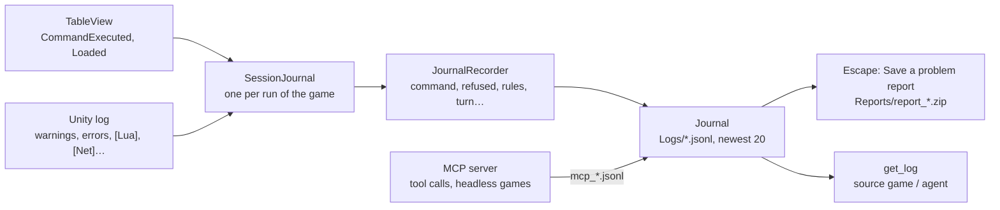

# The session journal: what happened, kept on disk

For whoever chases a bug from a playtest, or builds a game through an agent and wants to know why a move was refused.
Each machine keeps a **journal** of its session: one JSON object per line, written as it happens (a crash keeps
everything up to it). The game window writes one per run; the MCP server writes its own. Players send them with
Escape → *Save a problem report*; agents read them with the `get_log` tool.

| Box | Files |
|---|---|
| Journal | [Journal.cs](../../core/Logging/Journal.cs): `Start` (file name, pruning to `KeepFiles`), `Write`/`Text`, `Read` (memory), `ReadFile`, `Files`, `Bundle` (zip), `MaxBytes` cap |
| JournalRecorder | [JournalRecorder.cs](../../core/Logging/JournalRecorder.cs): `Table`, `Record` (one command and its events), turn lines |
| SessionJournal | [SessionJournal.cs](../../unity/Assets/_Project/Scripts/View/SessionJournal.cs): added by `TableView.Start`; `Folder`, `PlayerFolder`, `FolderOverride` (tests), `SaveReport` |
| Problem report | [HudController.cs](../../unity/Assets/_Project/Scripts/View/Hud/HudController.cs) `SaveProblemReport`, [EscapeMenu.cs](../../unity/Assets/_Project/Scripts/View/Hud/EscapeMenu.cs) `SaveReport` |
| MCP server | [LogTools.cs](../../mcp-server/LogTools.cs): `McpLogs.Folder`, the call-tool filter `McpLogs.Record`, `get_log`; [Program.cs](../../mcp-server/Program.cs) starts the journal; [GameSession.cs](../../mcp-server/GameSession.cs) `Recorder` |

## Where the files are

- The game: `Logs/` in the player's data folder (beside `Games/`; in Windows,
  `%USERPROFILE%\AppData\LocalLow\DefaultCompany\Table World\Logs`), named `<date>_<time>_<game>.jsonl`. The game writes
  this folder into `%LOCALAPPDATA%\TableWorld\game.json` (`logsFolder`), where the MCP server finds it.
- The MCP server: the same folder, `mcp_<date>_<time>_<file or agent>.jsonl`.
- Each kind keeps its newest 20 files; a file stops at 20 MB with a last line saying so.
- PlayMode tests write to a temporary folder (`JournalFolderForTests`), never the player's.

## What a line says

Every line has `seq` (from 1), `at` (UTC) and `kind`; most have `seat` (who did it or whom it concerns).

| Kind | Written when | Fields |
|---|---|---|
| `table` | a table is loaded (another one than before) | `game`, `id`, `source`, `rules`, `role` (solo, host, client, agent), `version` |
| `command` / `refused` | any command, done or refused | `command`, `args`, `action` (a rules action's name); refused: `code`, `reason`, `path` |
| `rules` | a rules log line | `text` |
| `private` | a line for some players only | `text`, `seat` (who reads it) |
| `auto` | the rules made a player's move for them | `action`, `args` |
| `shown` | a card was shown big | `card`, `to` |
| `turn` | the turn, phase, who is out, or the end changed | `turn`, `phase`, `current`, `out`, `over`, `winner` |
| `script` | a Lua `print` | `text` |
| `warning` / `error` / `log` | the Unity log: warnings, errors with a short stack, tagged lines (`[Net] …`) | `text`, `stack` |
| `tool` | the MCP server ran a tool | `tool`, `args` (long values cut), `ok`, `ms`, `reply` (its start) |
| `server` | the MCP server started | `version`, `file`, `games`, `bridge` |

## Secrets

A journal holds what its machine already knows. A client receives other players' secret choices without their
parameters and never sees their hidden cards, so neither does its journal; its private lines and shown cards are its
own. The host's machine holds everything its table holds, so the host's journal does too: it is the one to read for a
rules bug. An `auto` move of a secret action reaches other machines without its choice.
