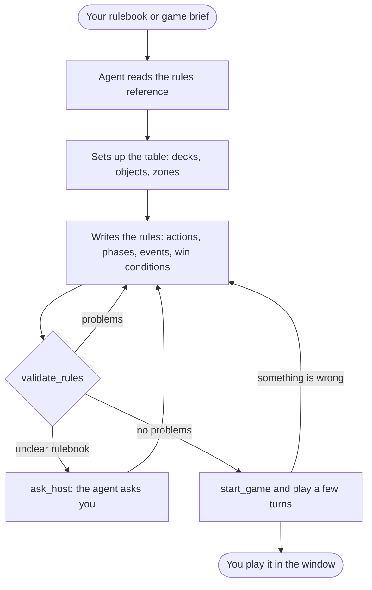

# Building a game with your agent

You describe your game; an AI agent builds it in Table World. This page is for designers: what you need, how to
connect your agent, what a session looks like, and what to do when it goes wrong. Most agents read their own
instructions from the server, so you do not need to explain the format to them.

## What MCP is

MCP (Model Context Protocol) is a standard way for an AI agent to use tools from another program. Table World ships an
MCP server: a small program that gives your agent tools such as `create_deck`, `add_action` and `start_game`. You keep
using the agent you already have (Claude Code, Claude Desktop, Codex). Table World holds no API key and no
subscription; the agent runs on your account.

## What the server can and cannot do

| It can | It cannot (yet) |
|---|---|
| Set up tables: decks (the built-in French deck or your own cards), tokens, tiles, dice, bags, boards and zones | Draw your card art: you supply the images |
| Write the rules: turns, phases, actions with choices, conditions, scores, events and win conditions | Check what a Lua script does: `validate_rules` checks the rules format, and scripts are tested by playing ([rules and scripting](rules-and-scripting.md)) |
| Check the rules, explain each problem, and suggest a fix | Decide what your rulebook means: when the rulebook is unclear, the agent asks you |
| Start a game and play it, as any seat, through the same rules a player's buttons use | Play online for you: online games are hosted from the game window |
| Show the table live in the Table World window while it builds | |
| Save and load games | |

## 1. Set up (once)

The server ships with the game (`TableWorld.Mcp.exe`, next to `TableWorld.exe`); you do not need .NET or this
repository.

1. Start Table World and open **Escape → Connect an AI agent**. The page shows the setup for Claude Code, Claude
   Desktop and Codex with your install's path already filled in, each with a **Copy** button:

   - **Claude Code:** paste the line into a terminal once. It looks like

     ```bash
     claude mcp add --scope user table-world -- "C:/…/Table World/TableWorld.Mcp.exe"
     ```

     `--scope user` makes the server available in every folder you start Claude Code in.
   - **Claude Desktop:** paste the block into `claude_desktop_config.json` (Settings → Developer → Edit config) and
     restart Claude Desktop.
   - **Codex:** paste the block into `~/.codex/config.toml`.

2. Start your agent in any folder and ask it to build a game (section 3). Each new game is saved in your Games folder
   under its id (the page shows where) and appears in **Games**, so you can open and play it later without the agent.
3. Keep the Table World window open to watch: it finds the agent's server by itself within a couple of seconds, and the
   page says "An agent is connected to this window now". Without the window the agent still builds and plays the game;
   you just cannot see it.

The server comes with the game it talks to, so updating the game updates both. If you set the server up from an older
install folder, copy the line again from the page.

### From the repository (developers)

Build the server with `dotnet build mcp-server -c Release` (never start it with `dotnet run`: its build messages would
break the connection).

- **Claude Code, inside this repository:** nothing to do. The repository's `.mcp.json` declares the server, and Claude
  Code asks you to approve it the first time. It saves your game to `games/my-game.json`.
- **Anywhere else:** in the Editor, Escape → Connect an AI agent gives the same lines pointing at the repository's
  Release build (`dotnet "<repo>/mcp-server/bin/Release/net9.0/TableWorld.Mcp.dll"`).

Server options: `--file <path>` saves every change to that one file and reopens it next time; without it, each
`new_game` gets its own file in the Games folder the game wrote to `%LOCALAPPDATA%/TableWorld/game.json` (or a `games`
folder where the agent runs, before the game has ever started). `--games <folder>` picks that folder instead, and
`--no-bridge` runs without a game window. A Windows build publishes the server next to the game
(`ShipMcpServer`); `python -I tools/mcp/smoke.py "<build>/TableWorld.Mcp.exe"` checks a published one.

## 2. The build loop



## 3. What to ask

The quickest start: give the agent your rulebook and a filled [game brief](game-brief-template.md). The brief answers
in advance what rulebooks usually leave out (ties, running out of cards, hidden information), so the agent asks fewer
questions. See the examples for [War](examples/war-brief.md) and [Match the Pile](examples/uno-lite-brief.md).

Prompts that work:

> Build my game in Table World. The rulebook is in `rules.txt` and the brief in `brief.md`. Validate the rules, ask me
> about anything still unclear, then start a game and play three turns as each seat to check it.

> Review this rulebook for Table World before building anything: list what is ambiguous or missing.

> In the game you built, a player who cannot play must draw until they can. Change that rule, validate, and show me
> a turn where it happens.

Most agents also show the server's ready-made prompts as slash commands or in a prompt menu:

- `review_rulebook` lists the questions to settle before building.
- `build_game_from_brief` builds, validates and test-plays the game.

The [MCP tools by job](mcp-tools-guide.md) page shows what each tool does, if you want to ask for something specific.

## 4. A real session, annotated

This is a session that builds Match the Pile ([its rulebook](../rulebooks/uno-lite.txt)) from the rulebook and its
brief. The tool calls and replies are real; long replies are cut (`…`).

**The agent creates the game and its two piles.** `new_game` also creates the seats and their hands.

```text
new_game     { id: "match-the-pile", name: "Match the Pile", players: 2, minPlayers: 2, maxPlayers: 4 }
  → {"ok":true,"problems":[]}
create_deck  { id: "draw", name: "Draw pile", x: -0.1 }
create_deck  { id: "discard", name: "Discard pile", cards: "[]", x: 0.1, faceUp: true }
  → {"ok":true,"problems":[]}
```

**It adds the two actions.** The server keeps them, and says the game is still incomplete: there is no turn yet.

```text
add_action   { id: "play_card", actor: "current", params: [card in $actor.hand],
               preconditions: [same suit or same rank as $obj.discard.top], effects: [move the card to discard, endTurn] }
  → {"ok":true,"problems":[{"path":"turn","code":"missing_field",
     "message":"Phases and actions need a 'turn' block.","suggestion":"Add { \"phases\": [ ... ] } under 'turn'."}],
     "hint":"Kept. The document is incomplete; fix the problems before start_game."}
add_action   { id: "draw_card", … the brief's rule: an empty draw pile is refilled from the discard, except its top }
```

**It adds the phase, the setup and the win condition, and validates.**

```text
add_phase          { id: "play", actions: ["play_card", "draw_card"] }
add_event          onGameStart: shuffle draw, deal 7 to each hand, turn one card onto the discard
set_win_condition  { when: $player.hand has 0 cards, winner: $player, checkAfter: anyCommand }
validate_rules
  → {"ok":true,"problems":[]}
```

**It starts the game and reads the table.** The server works out the legal moves: only the two hearts match the
2 of hearts on the discard, and it is not north's turn.

```text
start_game { seed: 3 }
  → … "discard": {"cards":1,"top":"2 of hearts"}, "currentSeat":"seat_south",
    "legalActions":{"seat_south":[{"action":"play_card","choices":[{"card":"queen_hearts"},{"card":"3_hearts"}]},
                                  {"action":"draw_card"}],
                    "seat_north":[]}
```

**It plays a move, then tests a wrong one.** The out-of-turn move is refused and changes nothing.

```text
perform_action { seat: "seat_south", action: "play_card", params: { card: "queen_hearts" } }
  → … "discard": {"cards":2,"top":"Queen of hearts"}, "currentSeat":"seat_north",
    "seat_north":[{"action":"play_card","choices":[8_hearts, jack_hearts, queen_spades, queen_diamonds]}, …]
perform_action { seat: "seat_south", action: "draw_card" }
  → {"ok":false,"errors":[{"path":"actor","code":"not_your_turn","message":"It is seat_north's turn, not seat_south's."}]}
```

The rules this session built behave like the finished game in [`games/uno-lite.json`](../../games/uno-lite.json).
A few turns do not reach every edge case, though, such as both piles running out. Ask the agent to play to the end
("play the game to the end as both seats"), or ask for the cases you worry about.

## 5. When the agent is stuck

| What you see | What to do |
|---|---|
| The agent loops on `validate_rules` with the same problem | Paste the problem to it and ask it to read `get_rules_reference` again. Problems name the exact path and usually the fix |
| It guesses instead of asking | Tell it: "ask me with ask_host whenever the rulebook does not say". A [brief](game-brief-template.md) removes most questions |
| It wants a rule the format cannot express | Ask it to describe the rule in a message at game start, and handle it at the table, or script it in Lua ([rules and scripting](rules-and-scripting.md)) |
| `start_game` refuses | The rules do not validate yet: ask for `validate_rules` |
| The game never ends | Ask for a limit, like War's 500 battles |
| `gameWindow: not connected` | The window is not in Play mode, or started before the server; it retries every 2 seconds. The server writes its address to `%LOCALAPPDATA%/TableWorld/bridge.json` |
| `game_unreachable` | The window stopped answering (Play mode ended). Start it again, or close it to play headless |
| The agent does not see the tools | Rebuild the server (`dotnet build mcp-server -c Release`) and restart the agent |
| An edit is refused while playing | Rules are locked during a game: ask for `reset_game` first |

## For agents

The agent-facing instructions are in [agent-guide.md](agent-guide.md). The server also serves them as the resource
`tableworld://docs/agent-guide`, together with the rules reference and the brief template.
