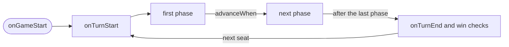

# Rules and scripting for designers

Your agent writes a game's rules for you, but you can read and change them yourself. This page explains the rules
format in game terms, from a simple game to a complex one, using the two sample games: War
([`games/war.json`](../../games/war.json)) and Match the Pile, a simplified UNO
([`games/uno-lite.json`](../../games/uno-lite.json)). The second half covers Lua, for the logic the format cannot express.

Exact field lists are in the [rules format reference](../reference/rules-format.md) and the
[design notes](../rules-schema.md); this page is the tour.

## 1. A game is one JSON file

A game file holds the table and the rules together:

| Part | What it is | War | Match the Pile |
|---|---|---|---|
| `game` | name, player count, description | War, 2–2 | Simplified UNO, 2–4 |
| `assets` | images, models, sounds | the built-in card images | the same |
| `objects` | what is on the table at the start | the main deck and each player's two piles | the draw and discard piles |
| `zones` | areas of the table: hands, hidden areas, snap points | none | the players' hands |
| `players` | seats: colour and hand | south (red), north (blue) | the same, each with a hand |
| `variables`, `resources` | numbers the rules keep | `battles` | none |
| `turn`, `phases`, `actions` | how play goes | battle, then resolve | one phase: play or draw |
| `events` | what happens at fixed moments | shuffle and deal at the start | shuffle, deal 7, turn up a card |
| `winConditions` | how the game ends | out of cards; 500 battles | empty hand |
| `ui` | panels on the screen | battle number and pile sizes | the top discard and the draw pile |

It is ordinary JSON, and `//` comments are allowed. Every id is lowercase letters, digits, `_` or `-`.

## 2. Turns and phases

A turn is a list of phases played in order. In each phase, only the actions it lists can be performed, and its
`advanceWhen` rule says when it ends.



Match the Pile has one phase. The current player either plays or draws, and both actions end the turn with
`endTurn`:

```json
"turn": { "order": "clockwise", "startingPlayer": "first", "phases": ["play"] },
"phases": [ { "id": "play", "name": "Play", "actions": ["play_card", "draw_card"] } ]
```

With no `advanceWhen`, the phase ends when an action says so (`endTurn` or `endPhase`). The other rules are:

| `advanceWhen` | The phase ends |
|---|---|
| `{ "immediate": true }` | as soon as its `onEnter` effects have run |
| `{ "allPlayersActed": true }` | when every seat has performed an action in it |
| `{ "condition": { ... } }` | when the condition holds, checked after every action |

War needs both players to act in the same turn. Its battle phase waits for everyone, then a resolve phase compares
the two cards straight away:

```json
{ "id": "battle", "actions": ["play_top_card"], "advanceWhen": { "allPlayersActed": true } },
{ "id": "resolve", "advanceWhen": { "immediate": true }, "onEnter": [ /* compare and take the cards */ ] }
```

## 3. Actions

An action is something a player can do. It has a `name` shown on buttons, `actor` (`current` for the player whose turn
it is, `any` for anyone), optional `params`, `preconditions` that must all hold, and `effects` that run in order.

War's only action takes no parameters:

```json
{ "id": "play_top_card", "name": "Play top card", "actor": "any", "limitPerPhase": 1,
  "preconditions": [ { "zoneCount": { "zone": "$actor.deck", "op": ">", "value": 0 } } ],
  "effects": [ { "move": { "from": "$actor.deck", "to": "$actor.battle", "faceUp": true } } ] }
```

Match the Pile's play action asks which card. The parameter is any card in the player's own hand, and the
precondition keeps only the cards that match:

```json
{ "id": "play_card", "name": "Play a card", "actor": "current",
  "params": [ { "name": "card", "type": "object", "filter": { "inZone": "$actor.hand", "type": "Card" } } ],
  "preconditions": [ { "or": [
    { "compare": { "left": "$param.card.meta.suit", "op": "==", "right": "$obj.discard.top.meta.suit" } },
    { "compare": { "left": "$param.card.meta.rank", "op": "==", "right": "$obj.discard.top.meta.rank" } } ] } ],
  "effects": [ { "move": { "object": "$param.card", "to": "discard" } }, { "endTurn": {} } ] }
```

The game works out every legal action with every legal choice. The HUD shows them as buttons, and your agent sees
them in `get_table_state`. A player never has to know the rules to play correctly.

**An action happens completely or not at all.** If any effect fails, the table goes back to how it was.

## 4. Naming things: `$` references

Rules rarely name one card. They say "the actor's deck" or "the top card of the discard pile". A `$` reference names
what you mean:

| You write | It means |
|---|---|
| `$actor`, `$current` | the seat performing the action; the seat whose turn it is |
| `$actor.hand` | that seat's hand zone |
| `$actor.deck` | the object tagged `deck:<that seat>`, so each seat gets its own pile from one rule |
| `$obj.discard.top` | the top card of the object `discard` |
| `$param.card.meta.rank` | the rank written on the card the player chose |
| `$var.battles` | the variable `battles` |
| `$seat.seat_north.battle.count` | how many cards are in north's battle pile |
| `$player`, `$other` | in a win condition: the seat being checked, and the next one |

`meta` is free data you put on cards (rank, suit, cost, colour). The built-in deck gives every card `rank` (2–14,
aces high), `suit` and `color`. A reference to something that does not exist right now, such as the top of an empty
pile, is empty, and comparisons with it are false.

## 5. Effects and conditions

**Effects** change the table: `move`, `deal`, `shuffle`, `flip`, `lock`, `roll`, `setVariable`, `setResource`,
`message`, `endTurn`, `endPhase`, `gotoPhase` and `win`, plus `if` and `forEach` to build logic from them.

**Conditions** ask questions: `zoneCount`, `compare`, `variable`, `resource`, `isCurrentPlayer`, `objectIn` and
`hasTag`, combined with `and`, `or` and `not`.

Each one is an object with a single key:

```json
{ "shuffle": { "object": "draw" } }
{ "not": { "isCurrentPlayer": { "player": "$actor" } } }
```

Match the Pile's draw action shows the usual pattern for a rulebook's "if the pile runs out" sentence:

```json
"effects": [
  { "if": { "condition": { "zoneCount": { "zone": "draw", "op": "==", "value": 0 } },
            "then": [ { "move": { "from": "discard", "take": "allButTop", "to": "draw" } },
                      { "shuffle": { "object": "draw" } } ] } },
  { "if": { "condition": { "zoneCount": { "zone": "draw", "op": ">", "value": 0 } },
            "then": [ { "move": { "from": "draw", "to": "$actor.hand", "faceUp": true } } ] } },
  { "endTurn": {} } ]
```

War's tie rule ("war!") puts one card face down for each player, then goes back to the battle phase with
`gotoPhase`. A player who cannot go to war loses through `win`:

```json
{ "forEach": { "players": true, "do": [
  { "if": { "condition": { "zoneCount": { "zone": "$it.deck", "op": "<", "value": 2 } },
            "then": [ { "win": { "player": "$other" } } ],
            "else": [ { "move": { "from": "$it.deck", "to": "$it.battle", "faceUp": false } } ] } } ] } },
{ "gotoPhase": { "phase": "battle" } }
```

## 6. Events, the end of the game, and the screen

`events` run at fixed moments: `onGameStart` (set up the table), `onTurnStart` and `onTurnEnd`. War counts its battles
in `onTurnEnd` with `{ "setVariable": { "name": "battles", "delta": 1 } }`.

`winConditions` are checked for each seat in turn (`$player`), either after every action (`anyCommand`) or at the end
of each turn (`turnEnd`):

```json
{ "when": { "zoneCount": { "zone": "$player.hand", "op": "==", "value": 0 } }, "winner": "$player", "checkAfter": "anyCommand" }
```

`ui` panels show labels, counters, images and buttons. Text in braces is filled in live, as each player sees it:

```json
{ "type": "label", "text": "Battle {$var.battles}" },
{ "type": "counter", "text": "South's deck", "value": "$seat.seat_south.deck.count" }
```

## 7. Editing a rule by hand

1. Open the game file in any text editor.
2. Change the rule. For example, in `games/uno-lite.json`, deal 5 cards instead of 7: in `onGameStart`, change the
   `deal` effect's `"count": 7` to `"count": 5`.
3. Ask your agent to check it: "load_game games/uno-lite.json, then validate_rules". You can also start the MCP
   server with `--file` on that file and call `validate_rules`.
4. Fix what it reports. Every problem names where it is, what is wrong and usually how to fix it:

```json
{ "path": "events.onGameStart[1].dael", "code": "unknown_effect", "message": "Unknown effect 'dael'.", "suggestion": "Did you mean 'deal'?" }
```

5. Start the game (`start_game`) and play a few turns to see the change.

Rules are locked while a game is running; `reset_game` goes back to the setup. All the error codes are listed in
[error codes](../reference/error-codes.md).

## 8. When the format is not enough: Lua

Some rules are easier to write as a script: a card with a one-off power, a calculation, a custom panel. Table World
runs **Lua** scripts the way Tabletop Simulator does, so TTS scripting tutorials apply. The full list of functions,
with their TTS names, is in the [Lua API](../lua-api.md).

Where scripts live:

- The table's global script is `scripts.global`.
- An object's script is its `script` field; inside it, `self` is that object.
- A zone can have a script too.

```lua
function onLoad()
  self.createButton({ label = "Draw 2", click_function = "drawTwo", function_owner = self,
                      position = { 0, 0.2, 1.6 }, width = 900, height = 300, font_size = 150 })
end

function drawTwo(obj, color)
  self.deal(2, color)
  broadcastToAll(color .. " drew two cards")
end
```

**Events** call functions by name. The common ones are:

- `onLoad` and `onSave`;
- `onObjectDrop`, `onObjectPickUp` and `onObjectFlip`;
- `onObjectEnterZone` and `onObjectLeaveZone`;
- `onPlayerTurn`;
- `onChat`;
- collisions.

The [Lua API](../lua-api.md) lists them all.

**Script UI:** scripts can make buttons and text fields on objects (`createButton`, `createInput`), and screen panels
in TTS's XmlUI (`UI.setXml`, `UI.setAttribute`, `onClick` handlers).

### The sandbox

Scripts are safe to run from a game someone sent you:

- They run only on the host, the player who loaded the game. Everyone else sees the result.
- They reach only the table: no files, no network, no other programs (`io`, `os`, `load` and `require` do not exist).
- Each call stops after 2 000 000 Lua instructions, so an endless loop cannot freeze the game. Errors are logged and
  never stop play.
- Everything a script does goes through the same commands a player's hands use, so it stays in sync for every
  player and can be saved and replayed.

### Differences from TTS Lua

- Positions are in TTS units (1 unit is about 3 cm) with the table surface at y = 0.96, so TTS scripts work
  unchanged.
- Not yet supported:
  - typing into XmlUI input fields drawn on objects;
  - joints;
  - asset-bundle effects;
  - scripted forces and velocities.

  These calls are accepted and do nothing.
- Player-colour chat (`broadcastToColor`) reaches everyone for now.
- Scripts never run on clients, so client-only tricks (a script reading what only one player sees) do not apply.

## 9. Rules format or Lua?

Use the rules format when you can. The game can then:

- list the legal moves;
- run thousands of test games headless;
- explain errors to your agent.

Use Lua for what the format cannot say yet, or when you import a TTS game, whose scripts come with it. A game can
use both: rules for the turn structure, Lua for a handful of special cards.
